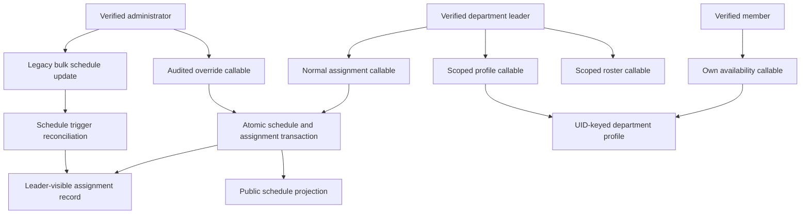

# Department authorization rule diagram

Date exceptions override recurring availability. Normal assignments require an
active, eligible, schedulable, available profile. Administrator override never
changes the profile and requires a recorded reason.
